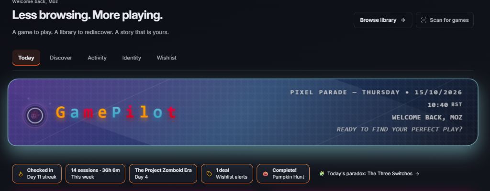
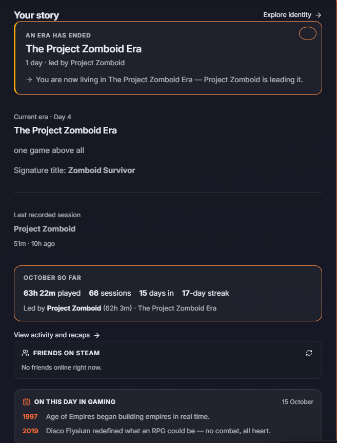
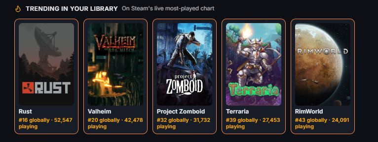
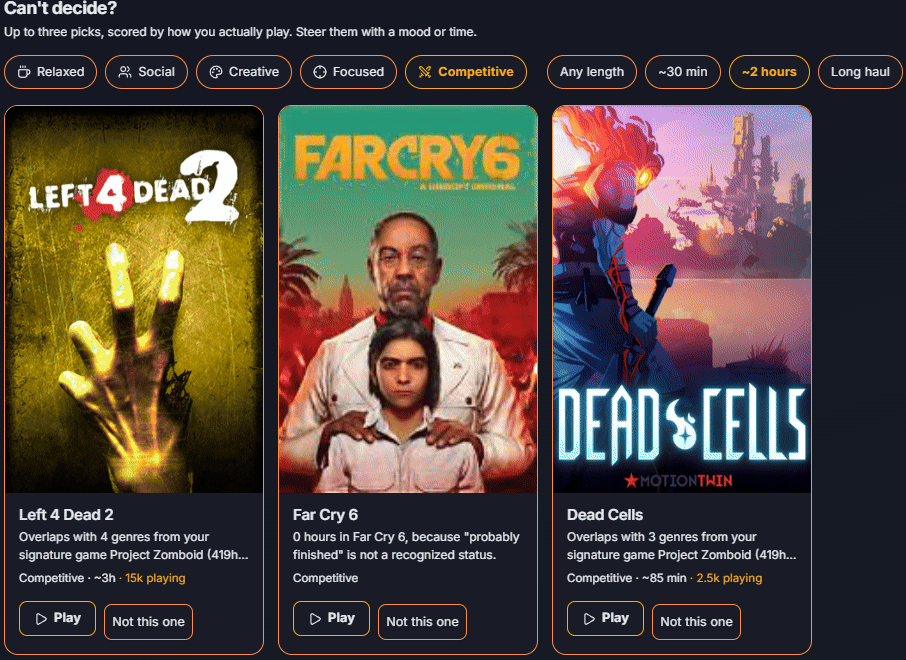
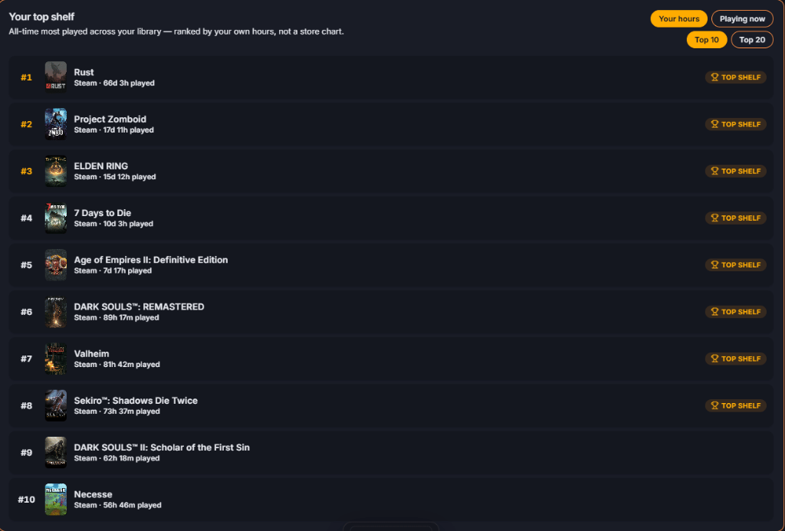
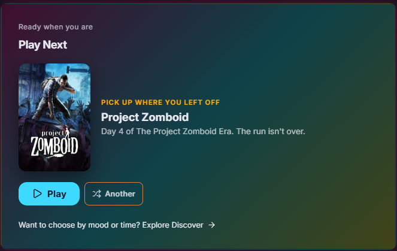
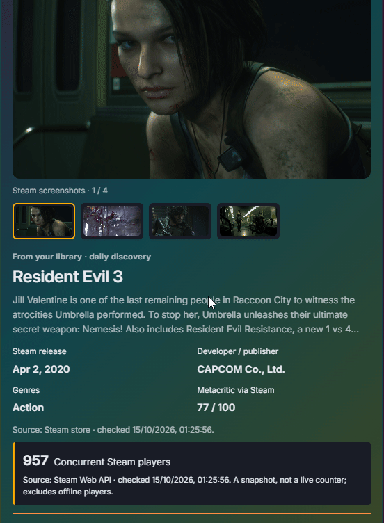
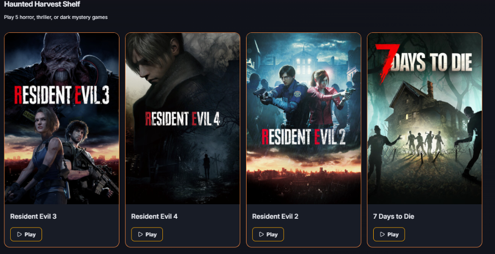
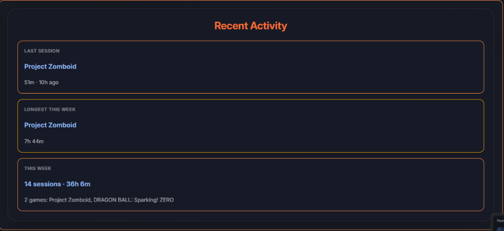

# GamePilot

**Less browsing. More playing. — and the record of how you actually play.**



I built this because I kept spending twenty minutes scrolling my Steam library and then closing it and watching YouTube instead.

GamePilot scans your games (Steam, Epic, GOG, Battle.net, itch, Xbox, and more — plus your emulator library), asks what mood you're in and how long you've got, and picks something from what you already own. While you play, it builds the record Steam never bothered to keep: real sessions, streaks, eras, and the games that owned you for a month at a time.

No account. No cloud. No telemetry. No AI in the app — everything it "knows" about you is local math on your own data. Windows 10/11, Linux in beta.

## Download

- **Windows:** [GamePilot-Setup.exe](https://github.com/jonnym69-ai/the-gamepilot/releases/latest) — Windows 10/11. SmartScreen will warn about the unsigned installer: **More info → Run anyway**.
- **Linux (beta):** x86_64 AppImage on the same releases page. Steam-first; works on Steam Deck in Desktop Mode — add it to Steam as a non-Steam game for Gaming Mode.
- **itch.io:** <https://moz91.itch.io/gamepilot>

## What it does

- Scans and launches games across Steam, Epic, GOG, Battle.net, Riot, itch.io, Xbox, Ubisoft, and manual installs
- **Eras** — when a game takes over your life for a month, it gets named ("The Zomboid Era") and the transition is commemorated
- Mood + time picks from your own library — with a reason attached, not a black box ("0 hours in Far Cry 6, because 'probably finished' is not a recognized status")
- **Trending in your library** — live Steam player counts and global chart rank for games *you own*, not the store chart
- "Owned, not installed" — Steam and GOG games you own but haven't installed, with one-click install deep links
- A persona and roast built from what you actually play (toggleable)
- Session tracking that works offline and across launchers — real sessions, not just lifetime totals
- Monthly recaps, check-in streaks, XP and achievements earned by playing, not buying
- Wishlist with price-drop alerts, and a giveaway radar for free-game dumps
- Save backups, an uninstall planner, big-screen TV mode, Discord Rich Presence

### First-class retro support

- Emulator profiles with **auto-detection** — finds RetroArch, Dolphin, PCSX2, PPSSPP, DuckStation, mGBA and more already on your PC
- **Box art** from the free libretro-thumbnails catalog — your SNES shelf looks like your Steam shelf
- **RetroAchievements** (opt-in) — achievement progress badges on your ROM library
- **BIOS detection** — advisory warnings before a console fails to boot (PS1/PS2/Saturn/Dreamcast and friends)
- **Save/savestate backup** through the same safe backup-and-restore pipeline as PC saves
- Region dedupe — `(USA)/(Europe)/(Japan)` variants collapse into one entry; multi-disc sets stay intact

## What it isn't

- Not a storefront, not a social network, not a Steam skin
- **No generative AI in the product** — the roasts are hand-written lines chosen by real session data, not a chatbot guessing. Built with AI-assisted development tools; the app itself contains none — point me at the API call and I'll eat the issue
- Doesn't sell anything — there's one build and everything in it is free
- Your data is a folder of files on your PC (`%AppData%\GamePilot` / `~/.config/GamePilot`), readable and deletable
- A one-person project — expect rough edges. Bugs and requests genuinely welcome in issues or the itch comments

## Screenshots

All from the current build on Windows.

| Your story — eras and transitions | Trending in your library |
| --- | --- |
|  |  |

| Can't decide? | Your top shelf |
| --- | --- |
|  |  |

| Play Next | Daily discovery |
| --- | --- |
|  |  |

| Seasonal shelves | Backlog Buster |
| --- | --- |
|  |  |

| Library | Recent activity |
| --- | --- |
|  |  |

## Development

Electron + React (Vite). The renderer also runs standalone for UI work.

```bash
npm install
npm start                 # dev server on :3000

npm run format:check
npx eslint src --max-warnings 0
npx jest --ci             # ~900 tests
npm run build             # production renderer build

npm run build-electron-win   # packages installer to ~/gamepilot-dist/
```

## License

MIT. Read the code, verify the privacy claims, build it yourself.
