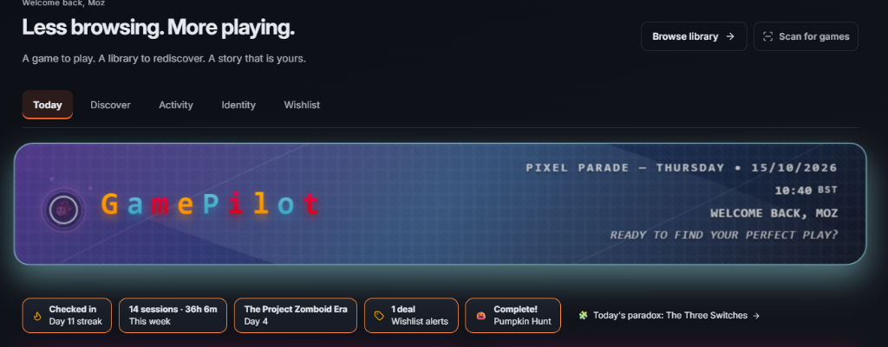
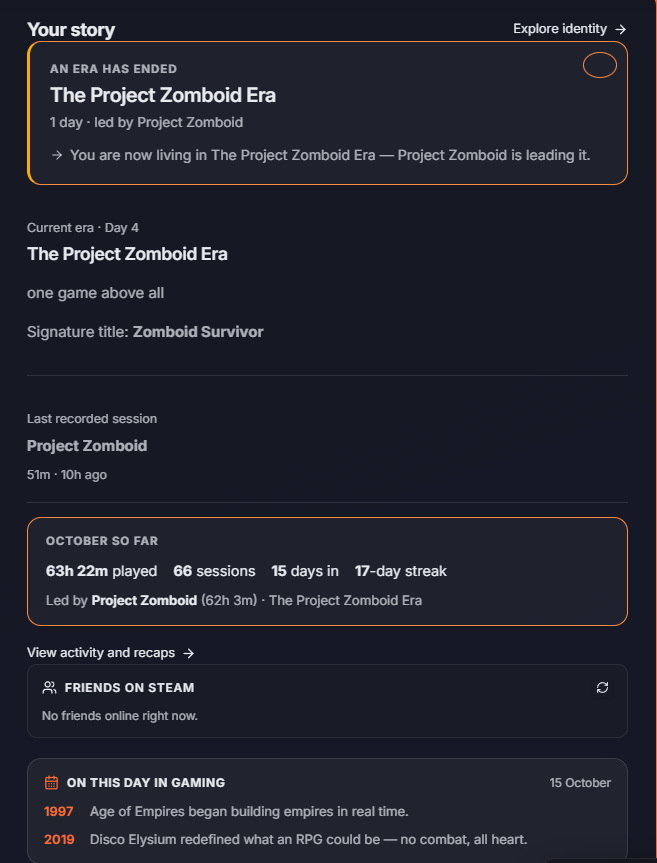
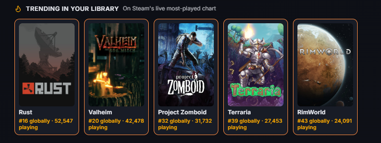
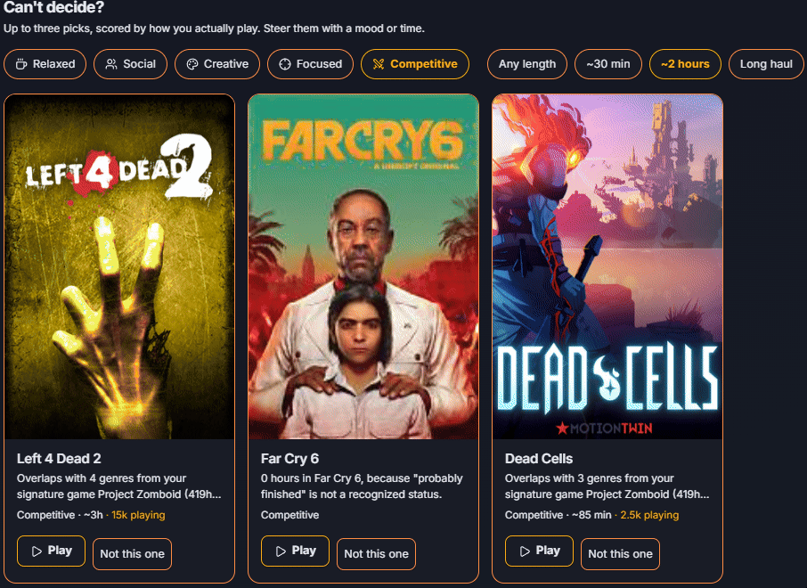
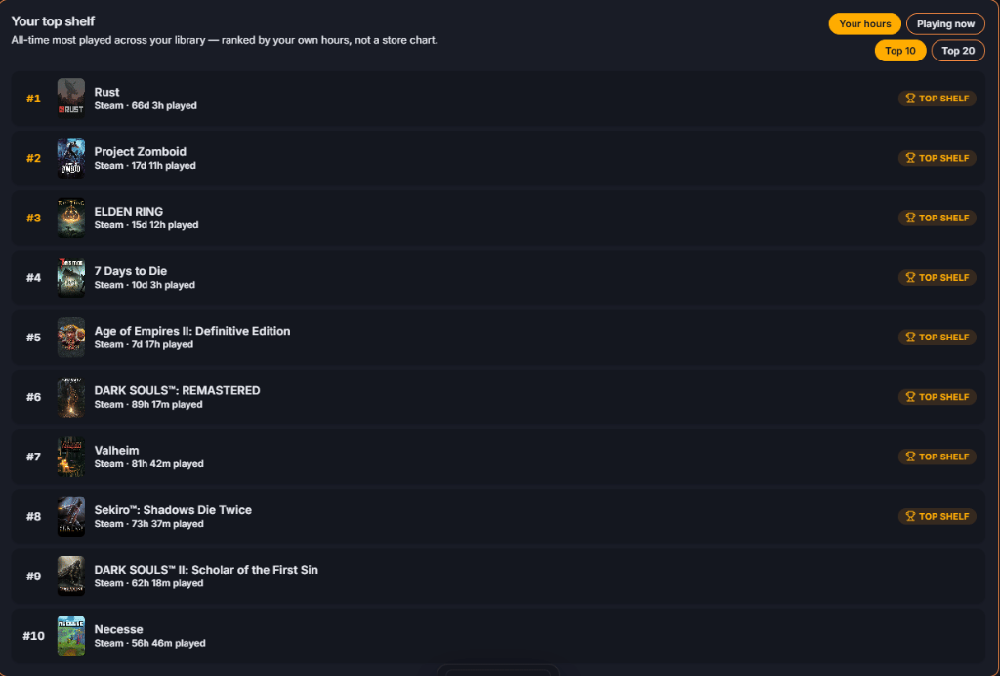
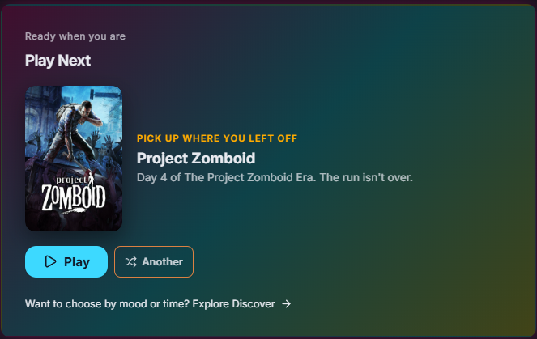
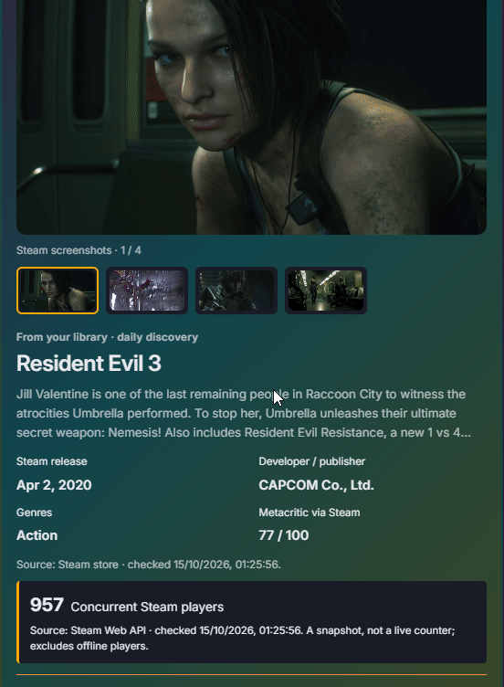
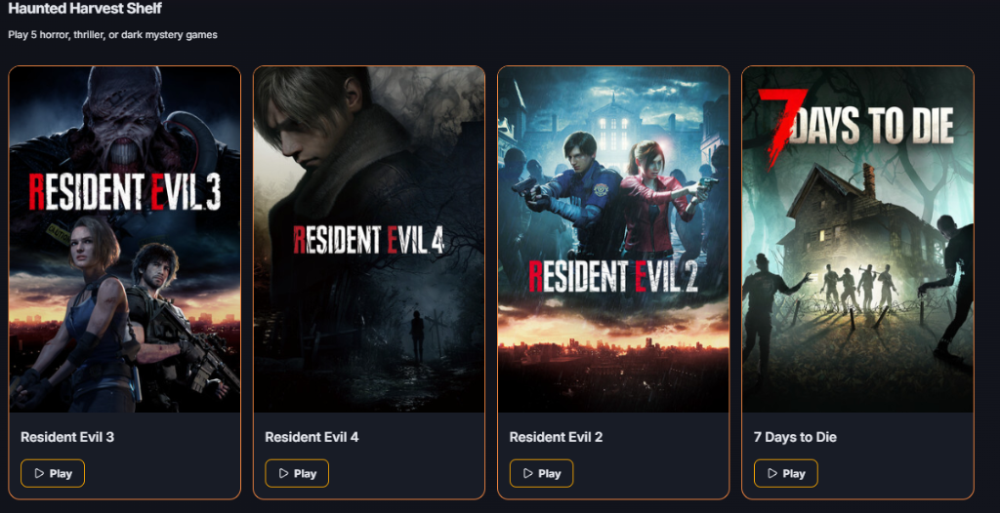
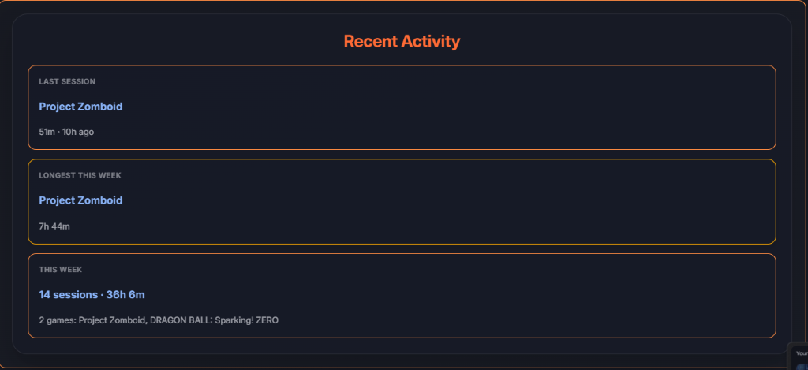

# GamePilot

**The record of how you actually play — from one launcher that runs everything you own.**



Steam knows your lifetime hours. GOG knows your last-played date. Nobody keeps the part that matters: the Tuesday nights, the month a single game owned you, the backlog title you finally finished at 2 a.m.

GamePilot tracks real sessions across every launcher on your PC — Steam, Epic, GOG, Battle.net, itch, Xbox, emulators and manual installs — and turns them into something you can actually read back: streaks, eras, weekly and monthly champions, habits, a Year in Review that updates all year. It learns what you play and when, and uses that to pick your next game from what you already own, with the reason attached.

And yes, it launches all of them from one place, so you stop scrolling and start playing.

No account. No cloud. No telemetry. No AI in the app — everything it "knows" about you is local math on your own data. Windows 10/11, Linux in beta.

## Download

- **Windows:** [GamePilot-Setup.exe](https://github.com/jonnym69-ai/the-gamepilot/releases/latest) — Windows 10/11, auto-updates built in. SmartScreen will warn about the unsigned installer: **More info → Run anyway**.
- **Linux:** paused — the Steam-only beta needs hardware validation, so no AppImage ships with the current release. The build stays in the tree (`npm run build-electron-linux`) if you want to try it yourself.
- **itch.io:** <https://moz91.itch.io/gamepilot>

## What it tracks

- **Real sessions**, not lifetime totals — start, end, length, time of day, across every launcher, offline, with crash recovery and a one-line journal per session
- **Eras** — when a game takes over your life for a month, it gets named ("The Zomboid Era") and the transition is commemorated
- **Hall of Champions** — the game that won each week, month and year, with hours, longest sitting and share of your play
- **Habits** — time-of-day heatmaps, weekday patterns, streaks, monthly recaps, On This Day, and a Year in Review that's live all year
- A persona and roast built from what you actually play (toggleable)
- **Your Steam achievements** per game, with rarity, alongside your own session record
- Shareable cards for all of it — eras, champions, your year, your library

## What it does with that

- Mood + time picks from your own library — with a reason attached, not a black box ("0 hours in Far Cry 6, because 'probably finished' is not a recognized status")
- "Finishable this weekend" — backlog games whose remaining HowLongToBeat time fits the time you have
- **Trending in your library** — live Steam player counts and global chart rank for games *you own*, not the store chart

## And the launcher part

- Scans and launches games across Steam, Epic, GOG, Battle.net, Riot, itch.io, Xbox, Ubisoft, Amazon, EA, Rockstar and manual installs
- "Owned, not installed" — Steam and GOG games you own but haven't installed, with one-click install deep links
- Edit any game's details — sort name, genres, tags, year, developer, cover art — when the scan gets it wrong
- Wishlist with price-drop alerts, and a giveaway radar for free-game dumps
- Save backups, rolling session-history backups, an uninstall planner, big-screen TV mode, Discord Rich Presence
- Auto-updates from GitHub releases (Winget and Scoop manifests live in `packaging/`)

### First-class retro support

- Emulator profiles with **auto-detection** — finds RetroArch, Dolphin, PCSX2, PPSSPP, DuckStation, mGBA and more already on your PC
- **Box art** from the free libretro-thumbnails catalog — your SNES shelf looks like your Steam shelf
- **RetroAchievements** (opt-in) — achievement progress badges on your ROM library
- **BIOS detection** — advisory warnings before a console fails to boot (PS1/PS2/Saturn/Dreamcast and friends)
- **Save/savestate backup** through the same safe backup-and-restore pipeline as PC saves
- Region dedupe — `(USA)/(Europe)/(Japan)` variants collapse into one entry; multi-disc sets stay intact

## What it isn't

- Not a storefront, not a social network, not a Steam skin
- **No generative AI in the product** — the roasts are hand-written lines chosen by real session data, not a chatbot guessing. Built with AI-assisted development tools; the app itself contains none — point me at the API call and I'll eat the issue
- Doesn't sell anything — there's one build and everything in it is free
- Your data is a folder of files on your PC (`%AppData%\GamePilot` / `~/.config/GamePilot`), readable and deletable
- A one-person project — expect rough edges. Bugs and requests genuinely welcome in issues or the itch comments

## Screenshots

All from the current build on Windows.

| Your story — eras and transitions | Trending in your library |
| --- | --- |
|  |  |

| Can't decide? | Your top shelf |
| --- | --- |
|  |  |

| Play Next | Daily discovery |
| --- | --- |
|  |  |

| Seasonal shelves | Backlog Buster |
| --- | --- |
|  |  |

| Library | Recent activity |
| --- | --- |
|  |  |

## Development

Electron + React (Vite). The renderer also runs standalone for UI work.

```bash
npm install
npm start                 # dev server on :3000

npm run format:check
npx eslint src --max-warnings 0
npx jest --ci             # ~900 tests
npm run build             # production renderer build

npm run build-electron-win   # packages installer to ~/gamepilot-dist/
```

## License

MIT. Read the code, verify the privacy claims, build it yourself.
